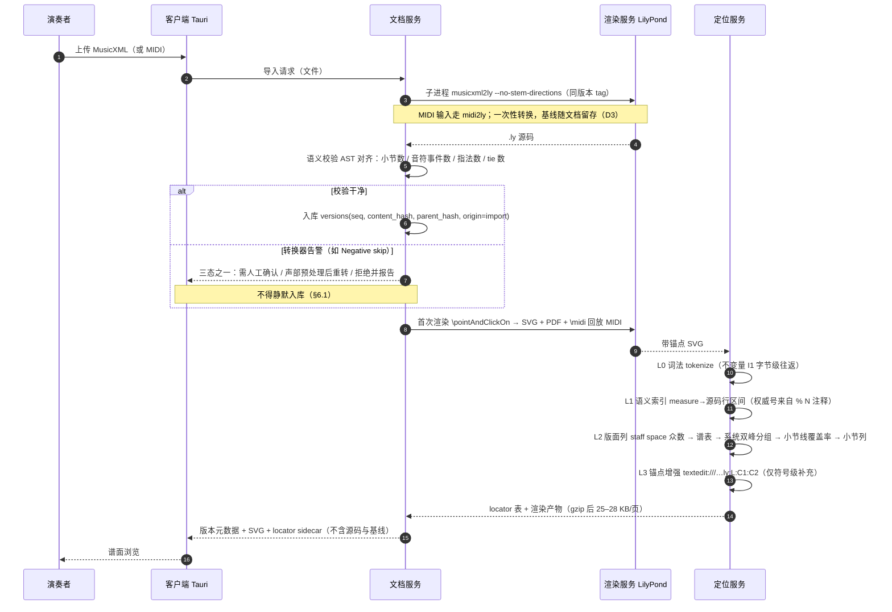
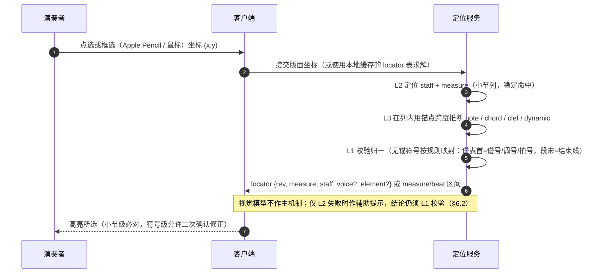
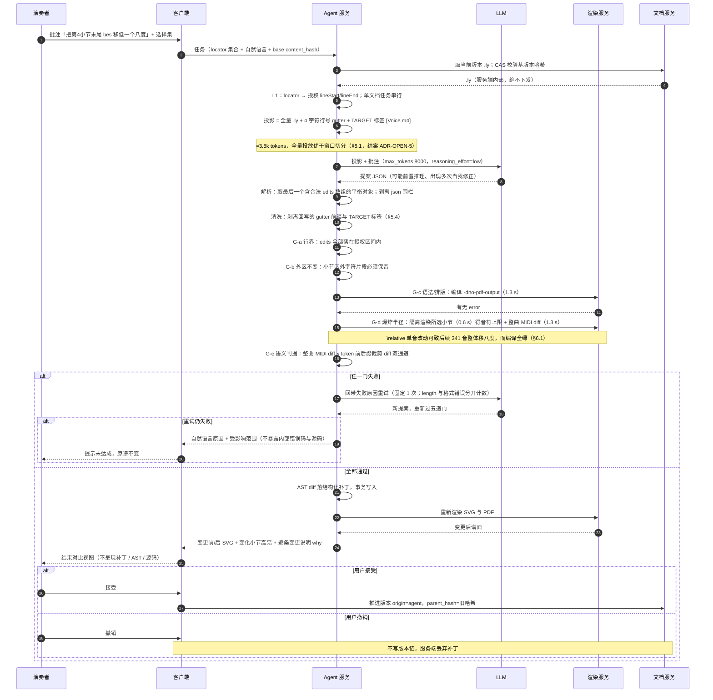
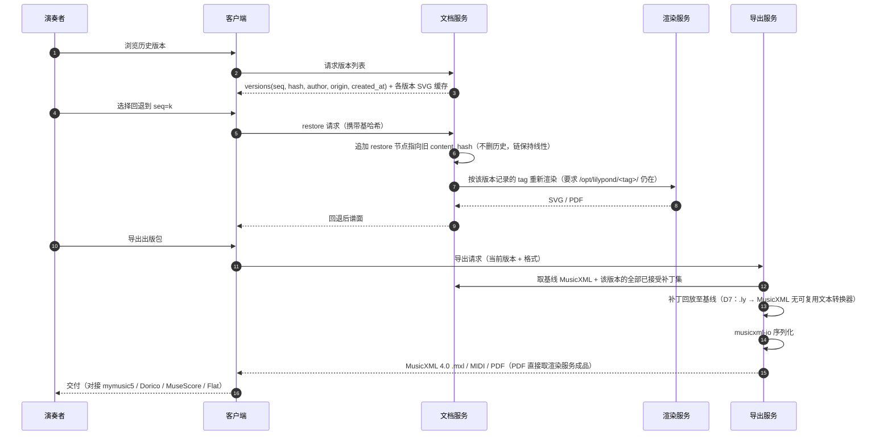

# Ossia 核心产品功能链路时序图

- 状态：Derived（由规范推导，不新增决策）
- 上游：[2026-10-08_tech-stack.md](./2026-10-08_tech-stack.md)（ADR-0001）、
  [2026-10-08_ly-parsing-indexing.md](./2026-10-08_ly-parsing-indexing.md)（ADR-0002）
- 日期：2026-10-08

本文把两份 ADR 的服务端五服务（A 文档 / B 渲染 / C 定位 / D Agent / E 导出）串成用户视角的四条产品链路。
图中每条分支与耗时标注都对应 ADR 条目，无新增决策；成本口径为 spike 实测值。

## 1. 参与者

| 标识 | 含义 |
|---|---|
| U | 演奏者（用户） |
| C | 客户端：Tauri 2，四端同一代码库；只见 SVG/PDF/摘要与 locator |
| A | 文档服务：版本链（DB + 内容寻址存储）、导入基线、CAS |
| B | 渲染服务：LilyPond 引擎子进程（`/opt/lilypond/<tag>/bin/`） |
| Cx | 定位服务：L0 词法 → L1 语义索引 → L2 版面列 → L3 锚点增强 |
| D | Agent 服务：投影 → LLM → 清洗 → 五道门 → 补丁 |
| E | 导出服务：基线 + 已接受补丁集 → MusicXML/MIDI |
| L | LLM |

贯穿所有图的两条不变量：**`.ly` 源码与基线 MusicXML 永不下发客户端**（G6、D9）；
**未经门禁校验的 LLM 文本不落盘**（G2、§6.4）。

## 2. 链路 1 · 导入：MusicXML → 可编辑可定位的乐谱

成本：转换 ≤ 2 s；L1 整曲 2.21 ms、L2 单页 4.4–6.3 ms；SVG 出图 ≤ 12 s（32 小节整曲实测 9.9 s）。

## 3. 链路 2 · 选择：点击 → locator

## 4. 链路 3 · 自然语言修改（核心链路）

成本：单任务 ≈ 1.5 模型秒 + 3.2 s 编译/门禁，另加 SVG 出图 ≤ 12 s。

唯一未闭合类别是「绝对音高计算」：提示规则能改变模型写法选择（`\absolute` /
`\resetRelativeOctave`）但补不上算错的八度，解法定为服务端由 L1 索引 + 音高状态机确定性提供目标音高事实
（ADR-0002 §6.3，ADR-OPEN-9，优先级最高）。

## 5. 链路 4 · 历史 / 回退 / 导出

## 6. 数据权威边界

| 数据 | 权威位置 | 是否下发客户端 |
|---|---|---|
| `.ly` 真源、投影文本、提案 JSON | 服务端（内容寻址存储） | 否 |
| 基线 MusicXML、补丁集、版本链 | 文档服务 A | 否 |
| SVG / PDF / 回放 MIDI | 渲染服务 B | 是（本地缓存） |
| locator `{rev, measure, staff, voice?, element?}` | 定位服务 Cx | 是（sidecar） |
| 变更说明 why、失败原因 | Agent 服务 D | 是 |
| 导出 .mxl / MIDI | 导出服务 E | 是 |

一句话链路：**导入定真源 → 三层定位收选择 → 批注驱动 Agent 在授权行区间改 `.ly` → 五道门把渲染危险挡在服务端 → 对比视图让演奏者决定 → 版本链留痕 → 补丁回放产出发布格式。**

G1 一致性由「`.ly` 同时是渲染源、编辑源与 Agent 读写面」这一结构保证，不依赖多表示间的同步纪律。
