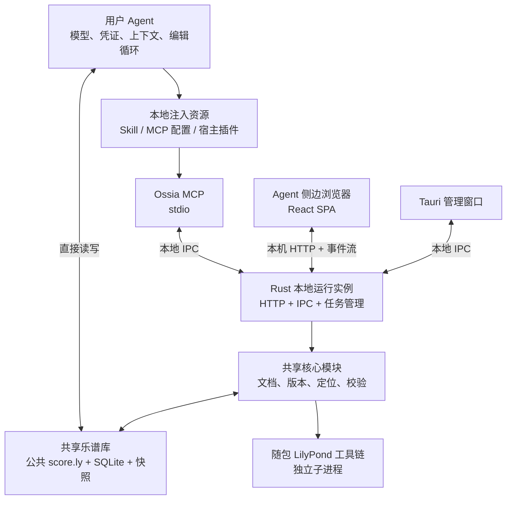

# Ossia 本地架构调整方案

- 日期：2026-11-10
- 状态：方案已对齐，产品架构切换待实施；P00 已建立本机基线与探针，Linux ARM64 验收受阻。
- 当前架构依据：[技术选型（ADR-0001）](./2026-10-08_tech-stack.md)、[解析与定位规范（ADR-0002）](./2026-10-08_ly-parsing-indexing.md)、[MVP 实现记录](./2026-10-09_mvp-build.md)。
- 分阶段实施：[实施总索引与共享契约](./2026-11-10_local-implementation/README.md)；P00 交付与阻塞见[基线报告](./2026-11-10_local-implementation/00-baseline-report.md)，P01–P07 待实施。

本文描述目标架构及实施方案，未标记为已完成的能力均需按第 5 节实现和验收。

## 1. 已确定的产品形态

Ossia 调整为完全本地运行的开源乐谱工具。用户在自己的 Agent 中提出修改要求，在 Agent 的侧边浏览器中浏览、选择和检查谱面；Ossia 提供文件、排版、定位、校验和版本管理能力。文件、工具执行和排版均在用户机器上；模型推理是否联网由用户的 Agent 配置决定。

| 项目 | 最终决定 |
|---|---|
| 任务入口 | 从 Codex、DSH 等用户 Agent 发起 |
| 谱面交互 | 在 Agent 的侧边浏览器中完成 |
| Tauri 窗口 | 提供运行状态、设置和宿主集成管理 |
| 本地核心 | 统一迁入 Rust，发布包不依赖 Node.js |
| 前端 | 保留 Vite + React SPA，移除 Next.js |
| 排版 | 随本体交付原生 LilyPond，首版不引入 WASM |
| 输入 | 单文件 `.ly`、MusicXML、MIDI |
| 输出 | `.ly`、PDF、MIDI；MusicXML 导出不纳入本次 |
| 选择 | 谱表与小节级选择，支持多选 |
| 编辑 | Agent 直接修改公共 `score.ly`，同一乐谱串行编辑 |
| 版本 | 自动预览；Agent 完成校验后显式提交版本 |
| 提交门槛 | 编译通过、版本与文件一致；音乐差异作为诊断 |
| 分发 | 只发布本体，由本体在本地注入 Skill／MCP／插件 |
| 数据 | 默认 `~/.ossia/`，项目内使用 `.ossia/`；各宿主共享所选乐谱库，旧数据移入废纸篓后从空库开始 |
| 许可 | 自有代码统一 GPL-3.0-or-later |
| 发布目标 | macOS arm64／x86_64、Windows x86_64、Linux arm64／x86_64 |

本次不提供移动端、Windows ARM64、云端服务、多用户账号、多文件 LilyPond 项目和内置 Agent 会话。

## 2. 目标架构与模块职责



### 2.1 Rust 模块划分

| 模块 | 职责 |
|---|---|
| 乐谱分析 | 无损分词、行列与字符位置、小节／声部索引、SVG 几何、音高解析、MIDI 差异 |
| 文档与版本 | 导入、公共源码、编辑所有权、快照、提交、回退、持久状态 |
| 排版工具链 | 引擎发现与校验、转换、编译、超时与取消、诊断、产物缓存 |
| 本地运行时 | 单实例管理、HTTP、IPC、事件、文件监听和任务调度 |
| CLI／MCP | 将核心能力暴露给终端和 Agent，不承载模型调用 |
| 宿主集成 | 检测宿主、生成配置、安装／移除本地集成、兼容性检查 |

现有 TypeScript 分词、定位、音高和 MIDI 逻辑迁入 Rust，以现有行为及引擎输出作为对照。迁移完成后移除旧 TypeScript 核心，避免维护两套判定规则。

React 只保留显示、用户交互和局部视图状态。源码解析、小节定位及版本状态由 Rust 提供。

### 2.2 进程模型

- 本体提供 GUI、`serve`、`mcp`、`doctor`、`integrate` 等启动模式；MCP 和服务模式无需初始化图形窗口。
- 每个数据目录只有一个运行实例，通过操作系统文件锁确立所有权；Unix 使用 socket，Windows 使用 named pipe。
- GUI、CLI 和 MCP 均连接该实例。实例不存在时，由本体启动本地服务。
- 运行时独立于侧边页面和 MCP 连接存活；关闭页面不终止编译。显式退出负责停止任务和清理端点。
- 默认不注册开机启动。开发环境使用独立数据目录和端口。
- 握手返回运行时版本、协议版本、数据 schema 版本和能力。客户端不兼容时明确失败，不另起写库实例，也不自动终止旧实例。

## 3. 文件、编辑和公共接口

### 3.1 本地数据

默认数据根目录为 `~/.ossia/`，项目内使用 `<项目根目录>/.ossia/`。提供数据目录覆盖参数，不增加版本子目录。

```text
.ossia/
├── library.sqlite3
├── documents/<documentId>/
│   ├── score.ly
│   └── original/
├── cas/
├── assets/
├── integrations/
└── run/
```

- `score.ly` 是唯一公共工作真源；导入原文件保留副本，原始路径不被写回。
- `.ly` 输入支持一个自包含文件和引擎自带标准库，不支持用户附带文件依赖。
- MusicXML／MIDI 继续由同版本转换器生成 `.ly`，保留导入报告；阻断性时间线错误继续拒绝导入。
- SQLite 保存文档、版本、编辑状态与任务；不可变源码快照使用 SHA-256 + gzip 内容存储。
- 每个版本具有独立 `versionId`、递增序号和 `parentVersionId`。内容哈希用于去重，不再兼任版本节点标识。
- 本次架构切换时，先停止对应的旧运行实例，将原有项目内 `.ossia/` 和 `~/.ossia/` 历史数据目录移入系统废纸篓，再在所选路径初始化空库。不做历史数据兼容、迁移或备份保留；文档、版本、补丁和渲染缓存均按此处理。此清理仅用于本次切换，不作为日常启动或后续升级行为。

### 3.2 Agent 编辑闭环

1. Agent 打开或导入文档，取得对应的侧边页面 URL 和 `viewId`。
2. 用户选择小节；选区绑定 `viewId`、文档和源码哈希。
3. Agent 读取选区，开始编辑任务，取得公共源码绝对路径和 `editId`。
4. Agent 用自己的文件工具直接编辑 `score.ly`。
5. 文件监听触发防抖编译，页面展示工作区谱面、诊断及未提交状态。
6. Agent 读取编译与差异结果，按需要继续编辑。
7. Agent 提交指定源码哈希；核心检查编辑所有权、基版本、当前文件和成功编译结果，在事务中追加版本。
8. 用户可查看历史和前后对比，也可执行回退。

具体一致性规则：

- 同一文档只允许一个编辑任务；其他会话可浏览，不可开始第二个写任务。不同文档可并行。
- 无法用应用锁约束任意文件工具，因此直接文件写入属于协作约定。发现任务外改动时标记异常状态，不归因给当前 Agent。
- 未提交修改在退出或崩溃后保留；重启进入恢复状态，不能默默重置文件或接管编辑任务。
- 编译始终读取固定快照，结果绑定源码哈希、引擎标识与编译参数。旧结果不能替换较新源码的预览。
- 提交源码与已编译快照不一致时拒绝提交。相同内容不重复创建版本。
- 回退追加新版本；存在未提交修改时先要求显式处理工作区，避免覆盖。
- 放弃编辑默认保留文件；丢弃工作区是独立操作，并携带期望源码哈希。

### 3.3 MCP／CLI 能力

CLI 和 MCP 调用同一套核心操作。MCP 使用 stdio，标准输出仅输出协议消息。

| 能力 | 关键输入／输出 |
|---|---|
| `ossia_guide` | 返回当前版本支持的工作流程与源码能力 |
| `ossia_status` | 运行时、引擎、库状态及兼容性 |
| `ossia_list` / `ossia_import` | 文档列表；导入报告、文档 ID 与源码路径 |
| `ossia_open` | 创建会话视图，返回 `viewId` 和本地 URL |
| `ossia_context` | 指定视图的文档、选区、源码范围、哈希及定位能力 |
| `ossia_edit` | 开始、恢复或结束编辑任务；返回所有权与源码路径 |
| `ossia_check` | 对指定源码哈希编译，返回任务、诊断和差异 |
| `ossia_commit` | 编辑 ID、基版本、源码哈希、修改摘要；返回新版本 |
| `ossia_history` / `ossia_restore` | 查询历史或追加恢复版本 |
| `ossia_export` | 指定版本、格式及可选目标路径；返回生成文件路径 |

补充约定：

- 所有会话相关调用显式使用 `viewId`，不依赖全局“最后打开的乐谱”。
- 选区落后于源码时返回 `stale-selection`，要求重新读取，不猜测落点。
- 长任务返回任务 ID，支持状态查询与取消；进程重启后未完成任务标记为中断。
- 对外统一使用 `conflict`、`edit-busy`、`dirty-workspace`、`compile-failed`、`unsupported-source`、`runtime-incompatible` 等稳定错误码。
- HTTP 和 MCP 共用 Rust 数据类型，生成前端类型，避免手写两套协议。

### 3.4 校验和定位

- 提交必须成功生成 SVG，并通过文件与版本一致性检查。
- MIDI 变化、选区外变化和 token 差异用于解释及诊断，不作为通用音乐正确性的证明。
- 支持转换器产物，以及常见单文件 `.ly` 的小节选择；索引无法可靠解释的语法返回能力状态和可用源码锚点，仍允许编译与 Agent 编辑。
- 首版不承诺音符级定位、完整 LilyPond AST 或自然语言意图自动判定。

## 4. 谱面页面、宿主注入与引擎交付

### 4.1 侧边谱面页面

页面包含乐谱列表／导入、多页谱面、小节选择、编译诊断、工作区与历史对比、恢复和导出，不提供模型设置或向 Agent 发任务的聊天框。

- 生产环境由 Rust 提供 Vite 静态产物，页面与接口同源。
- 本地 HTTP 只绑定 loopback，默认使用固定端口，允许显式覆盖；端口被未知程序占用时报告错误。
- IPC 返回真实访问地址；页面会话使用短期启动凭据换取访问令牌。接口校验 Host、Origin 和令牌，不提供任意跨站调用。
- 文件变化、任务进度、谱面和版本变化通过事件流推送；断线后先重新读取状态快照。
- 旧谱面可以在编译失败时继续显示，但必须明确标记为上一次成功结果。
- 导出由本地核心保存文件。未指定路径时保存到系统下载目录下的 Ossia 子目录，使用唯一文件名，返回路径及打开位置动作。

Codex 使用内置浏览器打开本地 URL；DSH 的本地插件通过其 Sidebar Browser 接口打开相同页面。没有浏览器面板的纯 CLI 宿主返回可访问 URL，不虚构面板能力。宿主能力依据：[Codex Browser](https://learn.chatgpt.com/docs/browser?surface=app)、[DSH Sidebar Browser](https://github.com/deepseek-ai/deepseek-harness/blob/master/packages/client/ui-sidebar-browser/README.md)。

### 4.2 Tauri 管理窗口与注入

管理窗口只提供运行状态、数据路径、引擎检查、宿主检测、集成安装／移除和问题诊断。

提供两种接入模式，使用相同运行时：

1. **Skill + MCP 注入**：适用于支持这些能力的 Agent。
2. **本地插件注入**：将 Skill、MCP 和打开侧边页面的宿主适配封装起来。

同一宿主避免同时启用两种模式，防止重复工具和技能。

- 本体携带集成模板及预构建插件资源；宿主侧不复制 LilyPond。
- 注入配置使用本体的绝对启动路径，不依赖 GUI 启动时的 shell PATH。
- Codex 插件通过受支持的本地 marketplace 注册；DSH 使用受支持的本地目录安装方式。需要宿主启用或重启时展示真实状态，不直接写插件缓存。接入依据：[OpenAI 插件打包文档](https://developers.openai.com/plugins/build/plugins)、[DSH 插件安装](https://github.com/deepseek-ai/deepseek-harness/blob/master/docs/user/develop/basic/publish.md)。
- 安装、升级和移除均幂等；记录本工具管理的条目，保留用户其他配置。发生同名冲突时不覆盖。
- 本体路径变更后可检测并修复注入。卸载集成不删除乐谱库。
- Skill 固定描述“读取选区 → 获得编辑权 → 编辑源码 → 编译检查 → 提交”，不包含模型凭证。

### 4.3 引擎与发布包

本体包包含 Rust 程序、SPA、LilyPond、转换器及运行所需依赖。用户安装后无需另装 Node.js、Python、Guile 或 LilyPond。

- 初始引擎固定为 2.26.0。官方四目标使用上游包；Linux ARM64 建立同版本源码构建与可重定位打包链。
- 引擎清单按目标记录来源、校验和、构建配方和依赖版本。启动时验证版本、目录完整性与基本编译能力。
- 保留工具链所需文件时间和执行权限；不在已签名安装目录中执行运行时自修复。
- 编译使用独立临时目录，提供超时、取消、进程树清理和受控并发；临时 HOME 与缓存目录指向可写位置。
- SVG 预览优先生成；PDF／MIDI 在需要时生成并缓存。无法安全生成 MIDI 的合法 `.ly` 返回明确诊断，不修改公共源码来满足导出。
- LilyPond 源码含 Scheme 执行能力，首版信任本地用户及其 Agent 提供的源码；子进程和资源限制用于故障控制。
- 自有代码统一 GPL-3.0-or-later。每次发布附对应源码、构建脚本、依赖来源与第三方许可材料。

Linux ARM64 没有当前官方预编译包，必须先完成自包含构建与真实运行验证，不能仅凭 Rust 构建成功宣称支持。引擎包依据：[LilyPond 下载列表](https://lilypond.org/download.html)。

## 5. 实施顺序与验收标准

### 5.1 实施顺序

以下为架构层的工作分组；后续 Agent 按[分阶段实施索引](./2026-11-10_local-implementation/README.md)中的 P00–P07 顺序执行，并以各阶段文档的契约和退出条件交接。

1. **固定架构和测试基线**

   新增本次 ADR，标记被替代的旧部署约束；整理可提交的 `.ly`、MusicXML、MIDI 合成样本，固定当前分词、索引及编译行为。先验证 Linux ARM64 工具链和宿主侧边页面接入。

2. **实现 Rust 核心与本地运行时**

   建立共享 Rust workspace，迁移乐谱分析、存储、引擎和定位；实现新库、公共源码监听、编辑所有权、哈希绑定任务、提交和恢复；接通 CLI／MCP。

3. **迁移 SPA 与管理窗口**

   SPA 接入本机接口和事件流，去掉服务端 Agent 请求及人工接受候选流程；Tauri 改为运行与集成管理窗口；跑通侧边页面中的完整编辑闭环。

4. **实现宿主集成与五目标发布**

   完成 Skill／MCP／插件本地注入，建立五目标引擎与应用打包、许可材料、安装检查和升级兼容测试。

5. **移除旧架构**

   Rust 路径完成对照测试后，移除 Next.js、服务端模型请求及环境变量、旧 HTTP 任务层和已迁移的 TypeScript 核心。更新开发命令与文档；按第 3.1 节将旧数据移入废纸篓并初始化新库。

### 5.2 必须通过的测试

| 类别 | 验收场景 |
|---|---|
| 源码分析 | 分词无损往返；转换器产物与常见手写谱的小节定位；压缩休止、多声部、多页；不支持语法明确降级 |
| 引擎 | 五目标真实执行三类导入、SVG、PDF、MIDI；中文、空格与长路径；正常日志、失败、超时、取消和崩溃清理 |
| 文件监听 | 连续保存、原子替换保存、暂时不存在、语法错误后修复；较旧编译不得覆盖新状态 |
| 编辑一致性 | 同谱第二个任务被拒绝；不同谱可并行；任务外写入、过期选区、过期提交均可检测 |
| 历史恢复 | 一任务一版本、无变化不新增；回退追加节点；未提交文件不被覆盖；崩溃后可恢复工作区 |
| 浏览器会话 | 多宿主、多页面选区互不串用；事件重连；失效凭据；服务重启与端口占用可诊断 |
| 宿主集成 | 重复注入、移除、升级、路径变更、已有同名配置；没有全局 Node／Python 时仍能运行 |
| 数据与分发 | 默认与项目内数据目录解析正确；本次切换将旧数据移入废纸篓，新库首次启动为空，后续启动和升级不重复清理；单实例锁有效；安装包外无构建目录依赖；离线排版可用 |

最终验收使用实际安装包完成：

**安装本体 → 注入宿主 → Agent 打开侧边谱面 → 导入 → 选择小节 → Agent 直接修改 `score.ly` → 自动预览 → 编译检查 → Agent 提交 → 查看历史／回退 → 导出。**

五个本体目标都需验证核心工具链；Codex、DSH 分别在其支持的实际宿主环境中验证面板交互。全部通过后，新的本地路径才成为唯一受支持架构。
